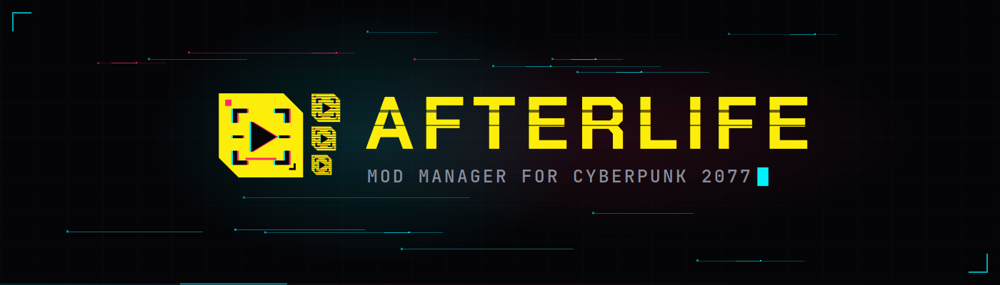
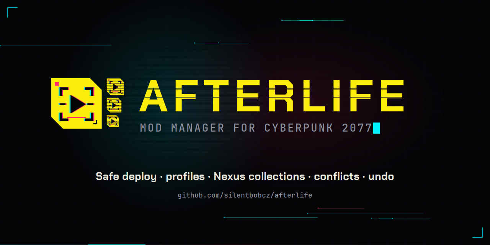

<p align="center">
  
</p>

<p align="center">
  <b>AFTERLIFE</b> · a safe, open-source mod manager for <b>Cyberpunk 2077</b> on Windows<br>
  <a href="docs/USER-GUIDE.md">User guide</a> ·
  <a href="docs/FAQ.md">FAQ</a> ·
  <a href="docs/HOW-IT-WORKS.md">How it works</a> ·
  <a href="CHANGELOG.md">Changelog</a> ·
  <a href="PRIVACY.md">Privacy</a>
</p>

---

> **Wake up, choom.** Your mod folder's a flatlined mess and the game's one bad archive away from a crash at the loading screen.
> AFTERLIFE keeps your chrome on ice in its own library and only jacks into Night City what you **load to the deck**.
> Every write gets logged, every file gets checked, and if the power dies mid-install it finishes the job or rolls you back. No ripperdoc needed.
> One profile for the street-kid run, one for the photo-mode tourist, one with nothing at all. Flip between them without reinstalling a single file.
> No telemetry, no corpo strings attached. Free, open source, MIT. Preem.

## Status

**Public beta (0.5.0).** It works on real installs and is still young. Keep a way back: your launcher's *verify files* option repairs the game, and AFTERLIFE never deletes files it did not put there itself.
The executable is not code-signed yet, so Windows SmartScreen shows a warning the first time (*More info → Run anyway*). See [FAQ](docs/FAQ.md#windows-says-it-protected-my-pc).

## What it does

| | |
|---|---|
| **Library outside the game** | Mods are imported into the AFTERLIFE library first (`.zip`, `.7z`, `.rar`, `.archive`, REDmod folders, FOMOD installers). Nothing touches the game folder until you apply. |
| **Load to deck** | *Apply changes* shows exactly what goes in and out, then writes with a crash-safe journal: temp file → hash check → intent record → rename → verify. A power cut can be finished or rolled back. |
| **Profiles** | Any number of profiles plus a built-in **Mods off**. Switching a profile changes nothing until you apply it. |
| **Core mods** | CET, RED4ext, redscript, ArchiveXL, TweakXL, Codeware, Input Loader and friends are recognised, shown in their own block and tracked as requirements of the mods that need them. |
| **Requirements** | Read from the mod files and from the Nexus Mods page. Missing ones are flagged in the list, with *Open page* to get them. Switching a mod on offers to switch on what it needs; switching it off offers to switch off what depends on it. |
| **Conflicts and load order** | File conflicts are shown per mod; pick the winner for one file or the whole mod. Archive load order by drag and drop (`modlist.txt`). |
| **Nexus Mods** | *Mod Manager Download* links go straight into the library. Update checks at start and every hour (one request for all mods). *Update all* for Premium accounts. |
| **Collections** | Add a Nexus collection: AFTERLIFE compares it with your library, downloads what is missing (Premium directly, free accounts page by page), keeps the curator's load order, and lets you switch the whole collection on or off. Core mods are never touched. |
| **REDmod and FOMOD** | REDmods are deployed with `redMod.exe` before launch; FOMOD installers get a step-by-step wizard. Installers and scripts inside archives are never run. |
| **Scan manual mods** | Finds mods you installed by hand, groups them by name and folder, and moves them into the library on request (always reversible). |
| **Export** | Copy or save the list of active mods with versions (text or CSV), for bug reports and for hunting the mod that breaks things. |

## Download

Get the latest release from **[Releases](https://github.com/silentbobcz/afterlife/releases)** (also on Nexus Mods once the page is approved):

- `AFTERLIFE-<version>-beta-win-x64.zip` · the app, a single `AFTERLIFE.exe`, .NET included, no installer.

Requirements: Windows 10 or 11 (64-bit), Cyberpunk 2077 2.x (Steam, GOG or Epic). No admin rights needed.

## Quick start

1. Unzip `AFTERLIFE.exe` anywhere you like (not inside the game folder) and run it.
2. Pick the game folder (the one with `bin\x64\Cyberpunk2077.exe`) and a library folder.
3. Optional: in **Settings**, paste your Nexus Mods personal API key and turn on *Open Mod Manager Download links in AFTERLIFE*.
4. Drop archives into the window, use **+ ADD MOD**, or click *Mod Manager Download* on a Nexus mod page.
5. Press **APPLY CHANGES**, check the list, **LOAD TO DECK**.
6. **JACK IN** starts the game.

Full walkthrough: **[User guide](docs/USER-GUIDE.md)**.

## Privacy in one paragraph

AFTERLIFE has no telemetry, no analytics and no self-updater. It talks only to Nexus Mods, and only when you have saved a Nexus key: mod details, requirements, update checks, collections, the files you download and the pictures of your mods. The key is stored encrypted for your Windows user (DPAPI). Details: **[PRIVACY.md](PRIVACY.md)**.

## Building from source

.NET 10 SDK on Windows:

```
dotnet build Afterlife.sln -c Release
dotnet test tests/Afterlife.Tests -c Release
```

Publishing the single-file executable and the project layout: **[docs/BUILDING.md](docs/BUILDING.md)**. Contributions are welcome, see **[CONTRIBUTING.md](CONTRIBUTING.md)**.

## Support and contact

- Bugs and ideas: [GitHub Issues](https://github.com/silentbobcz/afterlife/issues) (please attach *Settings → Copy diagnostics* and the exported mod list).
- Security issues: see [SECURITY.md](SECURITY.md).
- Contact: silentbob@silentbob.cz
- If AFTERLIFE saved your run, you can buy the author a drink at the Afterlife via [GitHub Sponsors](https://github.com/sponsors/silentbobcz). Entirely optional; nothing is locked behind it.

## License and credits

© 2026 Silentbobcz · [MIT License](LICENSE) · free and open source.
Bundled fonts Chakra Petch and JetBrains Mono are under the SIL Open Font License 1.1 (see `src/Afterlife.App/Assets/Fonts`). Third-party libraries: [THIRD-PARTY-NOTICES.txt](THIRD-PARTY-NOTICES.txt).

AFTERLIFE is an unofficial fan work and is not approved or endorsed by CD PROJEKT RED. It uses no game files or game artwork.
Cyberpunk 2077 is a trademark of CD PROJEKT S.A. Nexus Mods is a trademark of Black Tree Gaming Ltd. This project follows the [CD PROJEKT RED fan content guidelines](https://www.cdprojektred.com/en/fan-content).
