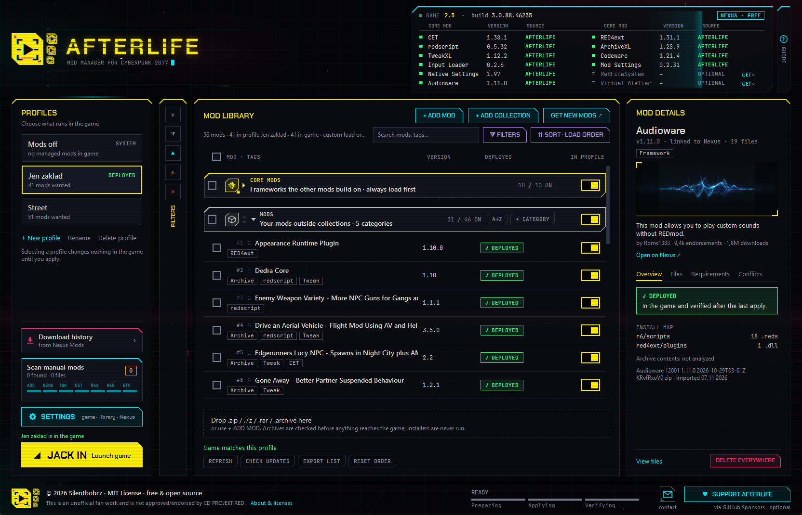
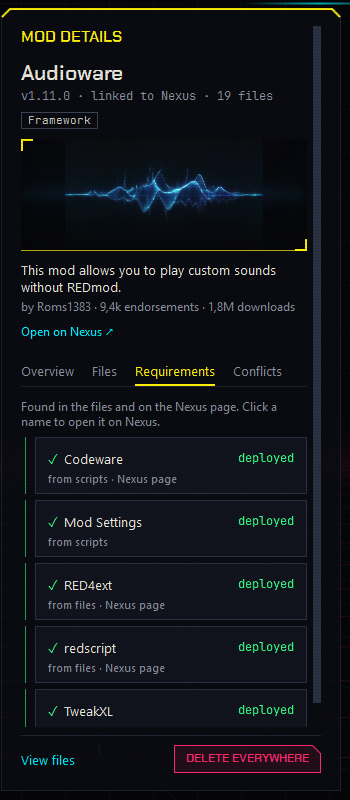
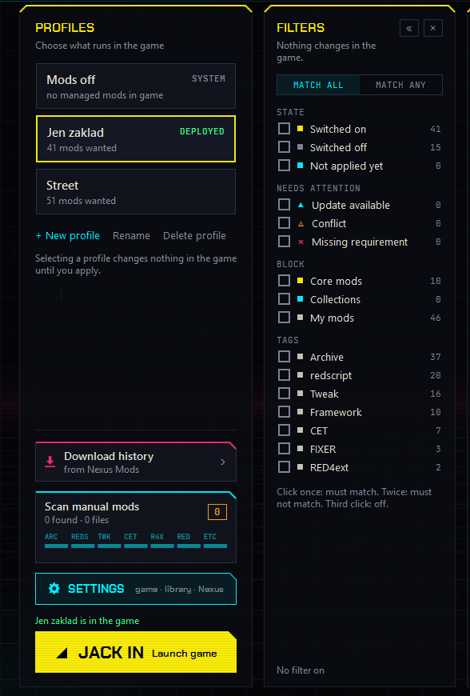
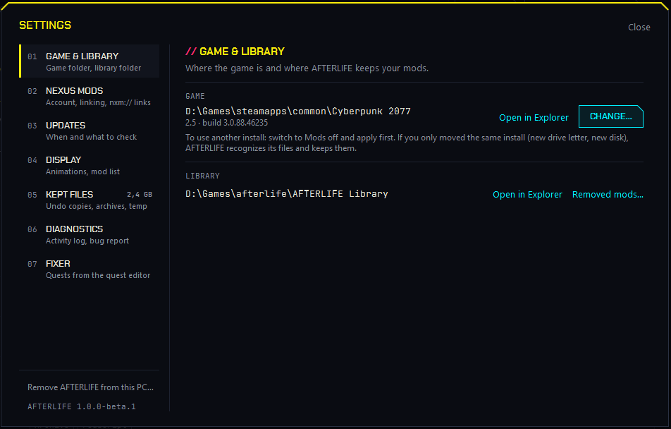
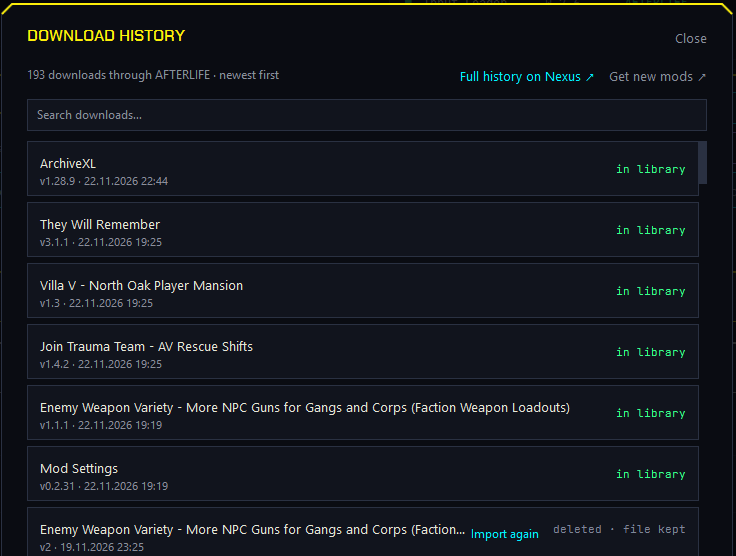

# A safe mod manager for Cyberpunk 2077

AFTERLIFE keeps your mods in its own library and puts into the game only what you apply. Every write is journaled and checked, so a crash or a power cut in the middle can be finished or rolled back. Free and open source (MIT), no telemetry.

ON GITHUB

<b>AFTERLIFE, the full edition.</b> With your Nexus Mods key it downloads mods, updates them and adds whole collections. An installer (recommended) or a zip.

ON NEXUS MODS

<b>AFTERLIFE Offline.</b> The same app, but it never connects to Nexus Mods: a program may use the Nexus Mods API only after Nexus Mods has registered it, and that is still open. <a href="faq.html#what-is-afterlife-offline-and-why-do-some-buttons-have-a-lock">More in the FAQ</a>.

<a class="btn primary" href="https://github.com/silentbobcz/afterlife/releases">Full edition on GitHub</a>
<a class="btn" href="https://www.nexusmods.com/cyberpunk2077/mods/36204">Offline on Nexus Mods</a>
<a class="btn" href="guide.html">Read the guide</a>

<figure class="shot shot-hero">

<figcaption>Profiles, the mod library and the details of one mod in one window. Core mods are tracked on their own and always load first.</figcaption>
</figure>

## What it does

- **Library outside the game** Mods are imported into the library first; nothing touches the game folder until you apply.
- **Profiles** Any number of profiles plus a built-in *Mods off*. Switching between them reinstalls nothing.
- **Crash-safe apply** Temp file, hash check, journal, rename, verify. Files AFTERLIFE did not put there are never overwritten or deleted.
- **Requirements and conflicts** Core mods are recognised and tracked, missing requirements are flagged, and you pick the winner of every file conflict.
- **Built for hundreds of mods** Filters, sorting for viewing, categories, bulk actions.
- **FOMOD, REDmod, manual mods** Installer wizards, REDmod deployment before launch, and a scan that finds what you installed by hand.

## Screenshots

<figure class="shot">

<figcaption>Requirements are read from the files and the Nexus page.</figcaption>
</figure>
<figure class="shot">

<figcaption>Profiles and filters: what needs attention is one click away.</figcaption>
</figure>
<figure class="shot">

<figcaption>Settings: the game folder and the library, kept apart.</figcaption>
</figure>
<figure class="shot">

<figcaption>Download history from Nexus Mods (full edition), with a way back for deleted mods.</figcaption>
</figure>

## Better with Nexus Mods Premium

AFTERLIFE works with a free Nexus Mods account, and it is at its best with **Premium**. Nexus Mods allows direct downloads through its API only for Premium members, and that is exactly what a mod manager needs:

| | Premium | Free account |
|---|---|---|
| **Update one mod** | downloads directly | one click on the download page |
| **Update all** | one question, then everything updates by itself | one click for each mod |
| **Collections** | the whole collection downloads by itself | one click for each mod |
| **Download speed** | uncapped | capped by Nexus |

With a few hundred mods that is one click instead of a few hundred. Premium also supports the mod authors and the site that hosts their work. Get it on [nexusmods.com](https://www.nexusmods.com/). AFTERLIFE itself stays free either way.

These features belong to the full edition from GitHub. In AFTERLIFE Offline from Nexus Mods they are visible with a lock.

## Start here

1. Run the installer, or unzip the folder `AFTERLIFE` anywhere outside the game folder and run `AFTERLIFE.exe`. Updating from an older version? [Keep the old folder](guide.html#updating-afterlife): your mods may be inside it.
2. Pick the game folder and a library folder.
3. Drop mod archives into the window, press **APPLY CHANGES**, then **JACK IN**.

The [user guide](guide.html) walks through everything; the [FAQ](faq.html) answers the usual questions.
